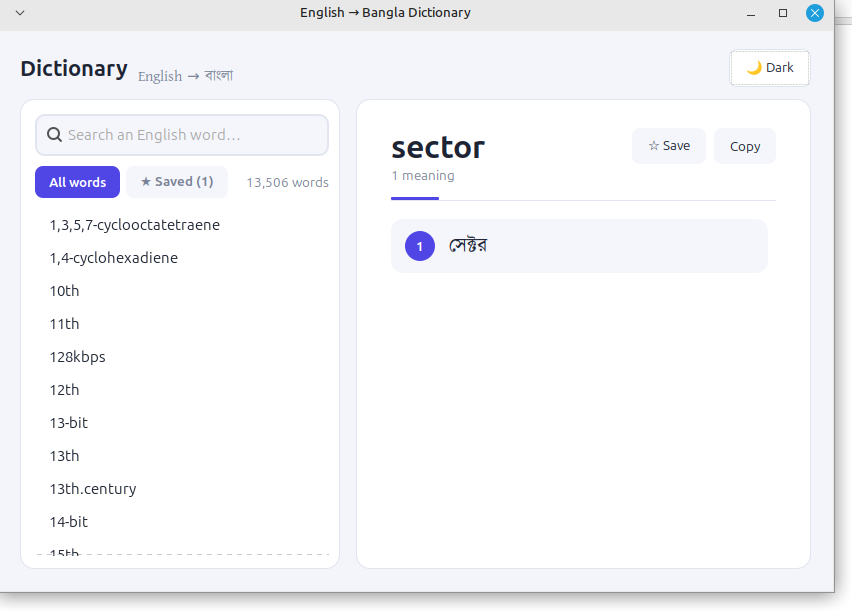
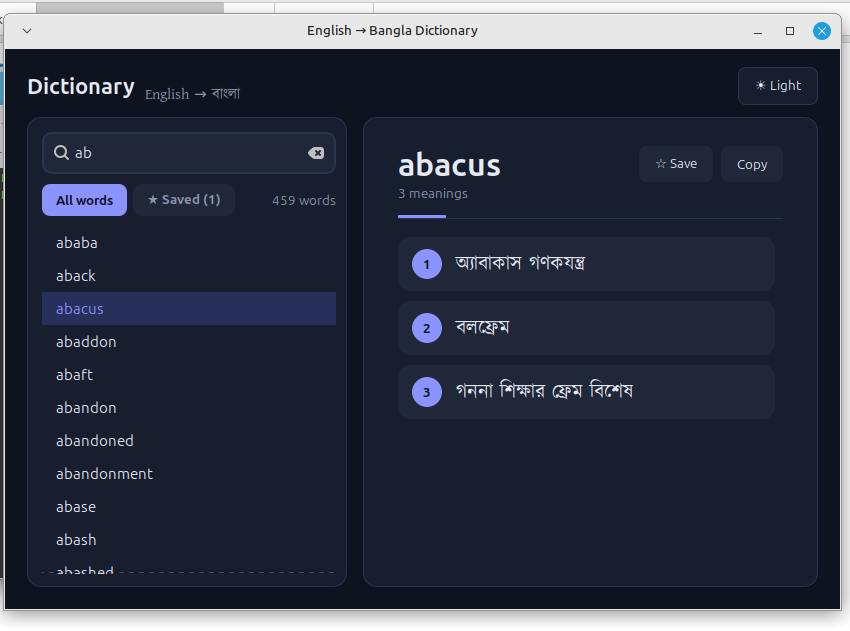
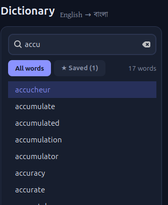

# English → Bangla Dictionary

A fast, offline, modern-looking desktop dictionary that translates **13,500+ English words** into **Bangla (বাংলা)**. Built with Python and GTK 3, with correct Bengali conjunct (যুক্তাক্ষর) rendering and no pip dependencies.


## Screenshots

| Light theme | Dark theme |
| :---: | :---: |
|  |  |

<p align="center">
  
</p>

## Features

- **Instant search-as-you-type**: prefix matches first, then words that contain your text
- **Offline**: all data ships with the app, no network needed
- **Correct Bangla rendering**: GTK + Pango shape conjuncts, vowel signs and reph properly
- **Favourites**: save words with ☆ and revisit them in the **★ Saved** tab
- **One-click copy** of a word and all its meanings
- **Light and dark themes**
- **Word of the day**: a random word opens on startup
- **Keyboard friendly** (see [shortcuts](#keyboard-shortcuts))
- **Lightweight**: Python standard library plus system GTK bindings, nothing to `pip install`

## Requirements

- Linux (developed and tested on Linux Mint)
- Python 3.8 or newer
- GTK 3 and the Python GObject bindings

| Distribution | Install command |
| --- | --- |
| Debian / Ubuntu / Linux Mint | `sudo apt install python3-gi gir1.2-gtk-3.0` |
| Fedora | `sudo dnf install python3-gobject gtk3` |
| Arch / Manjaro | `sudo pacman -S python-gobject gtk3` |

These are usually pre-installed on GTK-based desktops such as Cinnamon, MATE, XFCE and GNOME.

## Getting started

```bash
git clone https://github.com/zakariahossen/English-Bangla-Dictionary.git
cd English-Bangla-Dictionary
python3 dictionary_app.py
```

On Debian-based systems you can also run `bash run.sh`, which installs the GTK bindings if they are missing and then starts the app.

## Keyboard shortcuts

| Key | Action |
| --- | --- |
| Type in the search box | Filter words and show the best match |
| `↑` / `↓` | Move through results |
| `Enter` | Select the first result |
| `Esc` | Clear the search |
| `Ctrl + F` or `Ctrl + L` | Focus the search box |

## Project structure

```
.
├── dictionary_app.py     # the whole application (single file)
├── dictionary.json       # word → list of Bangla meanings
├── favorites.json        # created automatically when you save a word
├── fonts/
│   └── kalpurush.ttf     # bundled Bangla font
├── docs/
│   └── screenshots/      # images used in this README
├── run.sh                # convenience launcher for Debian-based systems
└── README.md
```

## How it works

### Data

`dictionary.json` is a single JSON object that maps a lowercase English word to a list of Bangla meanings:

```json
{
  "abandon": ["ত্যাগ করা", "পরিত্যাগ করা", "বর্জন করা"],
  "abbey": ["মঠ"]
}
```

At startup the `Dictionary` class loads the file, trims whitespace, drops empty entries and builds two parallel sorted lists: the original words and their lowercase forms.

### Search

1. The query is lowercased and trimmed.
2. **Prefix matches** are found with a binary search (`bisect`) on the sorted list, then collected while the words still start with the query.
3. **Contains matches** are found with a linear scan over the remaining words.
4. Results are shown as *prefix matches first, then contains matches*. An empty query lists every word.

With around 13.5k entries this is effectively instant, so no index or database is needed.

### User interface

| Component | Implementation |
| --- | --- |
| Window | `Gtk.Window` with a header, a sidebar and a detail panel |
| Search | `Gtk.SearchEntry` (re-filters the list on every change) |
| Word list | `Gtk.TreeView` + `Gtk.ListStore` in fixed-height mode, filled while detached from the view for speed |
| Tabs | Two linked `Gtk.ToggleButton`s: *All words* / *★ Saved (n)* |
| Meanings | One card per meaning, with a number badge and a wrapping, selectable label |
| Styling | A single CSS template filled from a colour palette and loaded through `Gtk.CssProvider` |

### Themes

Each theme is a plain dictionary of colours. Switching themes substitutes the palette into the CSS template, reloads the provider and toggles GTK's dark-theme preference. To add or tweak a theme, edit `THEMES` in `dictionary_app.py`.

### Fonts and Bangla rendering

Bengali needs complex text shaping, which GTK handles through Pango and HarfBuzz. On startup, **before GTK is imported**, the app registers every `.ttf` / `.otf` in `fonts/` with fontconfig (via `ctypes`), so the bundled font works without installing it system-wide. The CSS font stack then falls back to other installed Bengali fonts (Noto Sans Bengali, Lohit Bengali, SolaimanLipi, …) if the bundled font cannot be loaded.

### Favourites

Saved words are stored as a sorted JSON array in `favorites.json` next to the script and written every time you press ☆ Save. Words that no longer exist in `dictionary.json` are ignored when the file is loaded.

## Troubleshooting

**Bangla text shows as empty boxes**
Install a Bengali font, for example `sudo apt install fonts-noto-core`, and make sure `fonts/kalpurush.ttf` exists.

**`GTK 3 bindings not found`**
Install the packages from the [Requirements](#requirements) table.

**Window looks slightly different from the screenshots**
GTK themes (Mint-Y, Adwaita, …) can change small details. The app overrides most widget styling, but a few native elements such as scrollbars may vary.

## Roadmap

- [ ] Bangla → English reverse search
- [ ] Search history
- [ ] Text-to-speech for pronunciation
- [ ] Packaging (`.deb` / Flatpak)

## Contributing

Issues and pull requests are welcome. For larger changes, please open an issue first to discuss what you would like to change.


## Acknowledgments

- Dictionary data: [Ridmik Dictionary -- Rafi Kamal](https://github.com/rafi-kamal/Bangla-Dictionary) Modified and converted into JSON format for this project.
- [Kalpurush](https://fonts.ekushey.org/) Bangla font.
- Built with [GTK 3](https://www.gtk.org/) and [PyGObject](https://pygobject.gnome.org/).

## Contact
- Email: kochuprogrammer@gmail.com 
